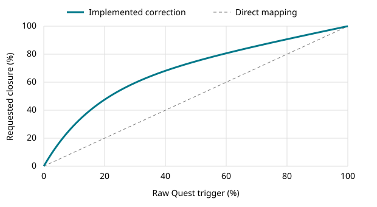
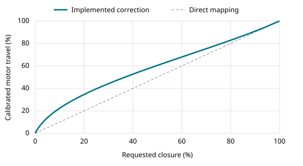

# UMI gripper

Two RS05 grippers, four Pi cameras and Quest teleoperation, with MCAP recording.

## Code map

| File | Responsibility |
| --- | --- |
| `backend/main.py` | Entry point, HTTP routes, startup and shutdown |
| `backend/app.py` | HTTP/WebSocket handlers connecting the interface to the hardware |
| `backend/gripper.py` | Calibration, left/right routing and the 200 Hz MIT loop |
| `backend/canbus.py` | RS05 CAN messages through the USB CANable serial adapter |
| `backend/cameras.py` | USB/CSI capture, preview and H.264 encoding |
| `backend/recording.py` | MCAP messages and episode lifecycle |
| `backend/utils.py` | Paths, environment settings, JSON persistence and input checks |
| `frontend/index.html`, `frontend/css/style.css` | Page structure and appearance |
| `frontend/js/app.js` | Gripper, Recording and Robot Episode interface |
| `frontend/js/vr.js` | Passthrough, panels, controller poses, triggers and recording buttons |
| `frontend/js/quest_camera.js` | Quest camera capture and transfer |
| `deploy/git_sync.py` | Pi-only Git updater |

## Run manually on the Pi

Use Python 3.11 or newer. Camera capture also needs `ffmpeg`, `rpicam-vid` and the appropriate Camarray driver/boot configuration. These hardware dependencies are not installed by the Git updater.

```sh
python3 -m venv .venv
.venv/bin/pip install -r requirements.txt
.venv/bin/python -m backend.main
```

Open `http://<pi-ip>:8080`. Quest WebXR needs a secure context: place a certificate trusted by the headset at `data/tls/cert.pem` and its key at `data/tls/key.pem`, then use `https://<pi-host>:8443`.

`UMI_DATA_DIR`, `UMI_HTTP_PORT` and `UMI_HTTPS_PORT` override the default data directory and ports. The first start copies defaults from `config/` into `data/`. Calibrations, TLS keys and episodes stay in `data/`, excluded from Git. No previous calibration or recording is included.

## Grippers and VR

Left motor: **18**. Right motor: **28**. Save each motor's open/closed positions in the interface before activation. `KP = 2.04`, `KD = 0.178571` and `PERIOD = 0.005` are in `backend/gripper.py`. Velocity target and feedforward torque are zero; the trigger sets the requested position. Zero velocity target is a damping reference, not a speed limit. The 200 Hz loop is a scheduling target, not a real-time guarantee.

Entering VR opens both grippers. Release each trigger once to take control. A toggles the right preview; X toggles the left. B starts recording or ends with success; holding B for two seconds ends with not judged. Y ends with fail. Motor faults and lost control/feedback stop actuation.

USB camera order is defined in `Cameras.usb_loop` in `backend/cameras.py`; CSI splits the Camarray image into torso left/right. Check the mapping after reconnecting hardware.

## Trigger mapping and grip control

**Quest input.** Both hands use the same fixed response: 45% raw trigger plus 55% normalized exponential response. This gives more weight to early trigger travel. The corrected value drives both the VR readout and the requested closure. Trigger lock freezes that request independently for each hand while contact and torque control continue.

```text
closure = 0.45 * raw + 0.55 * (1 - exp(-6 * raw)) / (1 - exp(-6))
```



**Linkage compensation.** The 12 mm crank drives the jaw through a connecting rod and rocker. The changing linkage angle gives a varying jaw displacement per degree of motor rotation. We invert the STEP-derived displacement curve using a 33-point lookup table, then scale the result between each motor's calibrated open and closed angles. For example, 30% raw trigger gives 59.5% requested closure and 67.6% motor travel in free space.



**Contact detection.** A separate forward lookup converts the requested and measured shaft angles into displacement at one pad tip. Contact requires at least 2.5 mm of closing error, measured closing torque above 0.18 N·m and shaft speed at or below 0.20 rad/s in magnitude across two distinct feedback samples. Contact clears at 1.0 mm of error. Measuring error at the tip accounts for the changing mechanical advantage across the stroke.

**Progressive hold and haptics.** The 200 Hz MIT loop keeps `KP = 2.04 N·m/rad` and `KD = 0.178571 N·m·s/rad` fixed. At contact we save the corrected trigger value. The remaining squeeze maps linearly to a holding torque target of 0.18–1.50 N·m and a rumble amplitude of 10–100%. We limit the motor's position lead to `hold_torque / KP` radians, capped by the remaining angle error. This bounds the proportional torque demand during a grasp. While locked, haptics guide the operator back to the saved trigger value within ±10 percentage points.

## Recording

MCAP stores independent camera frames and timestamps without forcing equal frame counts:

- `/cam/wrist_left`, `/cam/wrist_right`: wrist video.
- `/cam/head_stereo/left`, `/cam/head_stereo/right`: torso video (Origin topic names).
- `/cam/quest`: Quest video when camera capture is available and enabled.
- `/quest/poses`: headset/controller poses, including world and head-relative data.
- `/gripper/state`, `/gripper/record`, `/gripper/telemetry`: gripper state and measurements.
- `/origin/episode`, `/umi/events`: episode metadata and events.

The wire schemas are in `backend/schemas.json`. Missing camera streams are reported in episode metadata.

## Git updates on the Pi

Repository: https://github.com/Mousseauliam/UMI_gripper (branch `main`).

On the PC, use normal `git add`, `git commit`, then `git push`. Nothing watches files on the PC. On the Pi, `umi-git-sync.service` runs `deploy/git_sync.py`, checking GitHub every 10 seconds while Ethernet has a connection and IP address. It clones into `/home/admin/umi-v3`, then fast-forwards to new commits. Local changes or divergent commits are left untouched and reported in the journal.

```sh
sudo bash deploy/install-sync.sh
systemctl status umi-git-sync
journalctl -u umi-git-sync -f
```

Configuration: `/etc/umi-git-sync.json`. The read-only deploy key is `/home/admin/.ssh/umi_git_deploy`, stored only on the Pi. With Ethernet connected, Git checks main every 10 seconds. A separate timer checks the downloaded revision every 10 seconds and restarts umi-app whenever it changes, including during VR or recording. Open pages check the served revision every 5 seconds and reload automatically. The app uses /home/admin/umi-env and stores calibrations and episodes in /home/admin/umi-data. Re-run the installer after changing the updater. Until the repository has its first commit on `main`, the service waits and checks again every 10 seconds.

## CAD

[Onshape design](https://cad.onshape.com/documents/b1fdebf4e63a57263e618c6b/w/da7161f2845b0c85eb6ef8cc/e/bb00067b4393a12e92135545)

Put current STL/3MF exports in `assets/print/` and STEP exports in `assets/simulation/`. These folders are placeholders: no CAD export was supplied with the source, and older V1/V2 models have not been substituted.
